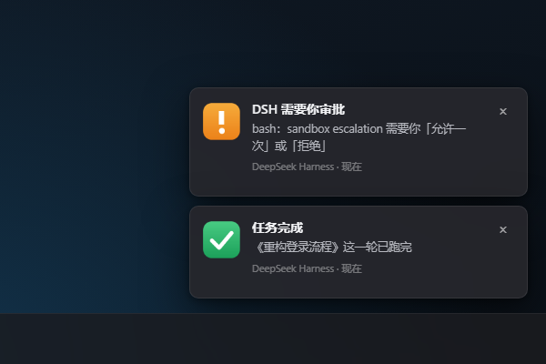

# dsh-desktop-notifier

> For the DeepSeek Harness desktop app on Windows: **approval requests pop up in the bottom-right corner**, and a finished turn **puts a red badge on the taskbar button and plays a chime** — even while DSH is minimized.

A Windows notification add-on for [DeepSeek Harness](https://github.com/deepseek-ai/deepseek-harness). Approval cards only live inside the window, so when you switch away nobody sees them and the task waits forever. This plugin moves both moments to the OS:

- **Approval → a toast in the corner.** A pending `approval/request` becomes a native notification with the tool name and the reason. Silence while DSH is focused; a banner when you are elsewhere, minimized, or fullscreen.
- **Completion → a taskbar badge.** Each finished turn adds one to a red counter over the DSH taskbar button, with a chime. Switching back to DSH clears it.
- **Zero dependencies.** Node built-ins plus the PowerShell 5.1 that ships with Windows. No runtime to install, nothing to compile.



<sub>Rendered by `demo/index.html`; capture instructions and a recording script live in [docs/DEMO.md](docs/DEMO.md) (Chinese).</sub>

## Requirements

- Windows 10 1809+ or Windows 11 — the badge and the notification are both Windows features; other platforms disable the plugin silently.
- DeepSeek Harness desktop 0.2.1+.
- Nothing else: the host half uses Node built-ins, the notification and badge halves are PowerShell 5.1.

## Install

Let DSH install it (recommended) — from the Plugins page, or through the built-in `plugin_manager`:

```
install_bundle  target = github:qmzh-zyz/dsh-desktop-notifier
```

Manual install from a local checkout is documented in the Chinese README; the short version is: copy the repo somewhere permanent, `pnpm add link:<path>` inside `~/.dsh/profiles/desktop`, add `"dsh-desktop-notifier"` to `dsh.profile.bundles`, restart.

Verify the two halves without waiting for a real approval:

```powershell
node tools/demo.mjs focus            # {"ok":true,"focused":false,"foreground":"msedge"}
node tools/demo.mjs toast approval   # a real approval banner in the corner
node tools/demo.mjs badge 3          # a real taskbar badge, cleared after 4s
node tools/demo.mjs chime            # the fallback chime on its own
```

## Configuration

Override in the profile's `cordis.patch.yml` under the entry id `desktop-notifier`:

```yaml
- id: desktop-notifier
  config:
    badgeColor: '#f5455c'
    approval:
      repeat: 2            # two extra reminders while nobody answers
      scenario: urgent     # break through Do Not Disturb and fullscreen
    completion:
      minTurnMs: 5000      # ignore turns shorter than 5s
```

| Key | Default | Meaning |
| --- | --- | --- |
| `enabled` | `true` | Master switch |
| `windowMatch` | `DeepSeek Harness` | Process name that owns the taskbar button |
| `badgeColor` | `#f5455c` | `#rgb`, `#rrggbb` or `#rrggbbaa` |
| `clearBadgeOnFocus` | `true` | Clear the badge when the window comes back |
| `approval.enabled` | `true` | Approval banners |
| `approval.skipWhenFocused` | `true` | Stay quiet while DSH is in front |
| `approval.scenario` | `auto` | `auto` tries `urgent` → `alarm` → `default`; the first two are the only Windows reminder classes allowed through DND and fullscreen |
| `approval.sound` | `true` | One chime with the banner |
| `approval.title` | `DSH 需要你审批` | Banner title |
| `approval.repeat` / `repeatIntervalSec` | `0` / `20` | Extra reminders while an approval is unanswered |
| `completion.enabled` | `true` | Completion reminders |
| `completion.badge` | `true` | Taskbar counter |
| `completion.toast` | `true` | Also show a completion banner |
| `completion.sound` | `true` | Chime; a standalone chime is used when the banner is off |
| `completion.skipWhenFocused` | `true` | No reminder while you watch DSH |
| `completion.scenario` | `default` | Completion stays unobtrusive |
| `completion.minTurnMs` | `2000` | Shorter turns do not count |
| `debugLog` | empty | File path for one JSON line per action |

## How it works

```
approval/request (waterfall, prepend + global)
  └─ dedupe by callId → focus gate → payload JSON
       └─ powershell.exe assets/notify.ps1
            ├─ WinRT toast (scenario=urgent/alarm, breaks DND + fullscreen)
            └─ tray balloon when the process has no package identity (0x80073D54)

session/event → turn/end (reason.kind === 'completed')
  └─ skip subagents → duration gate → focus gate
       ├─ badge: long-lived assets/badge.ps1, one command per line
       └─ banner: the same notify.ps1
```

Deliberate choices:

- **The plugin never answers an approval.** It calls `next()` and changes no semantics; a failed notification only reaches the debug log.
- **`prepend: true, global: true` is required.** The approval service dispatches through `scopeTarget(agent, agent)`, and a scope-bound listener can be filtered out before it runs.
- **Two notification channels.** WinRT toasts need a package identity; when the process has none, the tray balloon takes over so a reminder is never dropped.
- **The badge is not drawn by Electron.** The host does not own the taskbar window, so `setOverlayIcon` is unreachable; `ITaskbarList3::SetOverlayIcon` is called from a helper that exits with its parent.
- **Subagent turns never count.** Ten subagents still add one.

## Known limitations

- Windows only for both the badge and the notification channel.
- The tray-balloon fallback cannot break through exclusive-fullscreen; that is a WinRT `urgent`/`alarm` privilege. When toasts are available this does not apply.
- Clicking a notification does not return to DSH (no protocol activation yet).
- Multiple DSH instances: the helper picks the first window by process name; use `windowMatch` to pin it.
- Banner copy is Chinese; `title` is configurable.

## Development

```powershell
npm test                      # 33 node:test cases
npm run icons                 # regenerate assets/*.png
powershell -NoProfile -ExecutionPolicy Bypass -File assets/notify.ps1 -JsonPath payload.json -DryRun
powershell -NoProfile -ExecutionPolicy Bypass -File assets/badge.ps1 -SelfTest
```

## Related projects

- [Gusheng-GS/dsh-desktop-alerts](https://github.com/Gusheng-GS/dsh-desktop-alerts) — notifications only, with the most complete DND/fullscreen work and click-to-focus.
- [gaolvsuan/dsh-badge](https://github.com/gaolvsuan/dsh-badge) — badge and chime only.
- [xubin0628/dsh-task-notifier](https://github.com/xubin0628/dsh-task-notifier) — in-app banner, sound and system notifications for four event kinds.

## License

[MIT](LICENSE)
