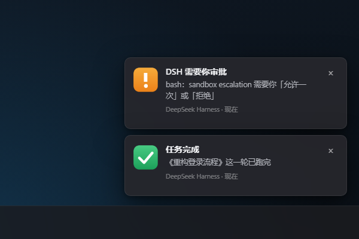

# dsh-desktop-notifier

> 你最小化 DSH 之后：**审批请求在桌面右下角弹出来**，**任务跑完在任务栏图标上挂一个红色角标并响一声**。

给 DeepSeek Harness 桌面版的 Windows 提醒插件。审批卡片只在窗口里，切走以后没人看得见；这个插件把两件事挪到系统层：

- **审批 → 右下角通知**：`approval/request` 一发生，就在桌面右下角弹一条通知（标题 + 工具名 + 申请原因）。DSH 在前台时不打扰；切走、最小化、看视频时才弹。
- **完成 → 任务栏角标**：一轮任务跑完，DSH 的任务栏按钮上叠一个红色数字角标（1、2、3…），同时响一声提示音；切回 DSH 后角标自动消失。
- **零依赖**：只用 Node 内置模块 + Windows 自带的 PowerShell 5.1，不用装运行时、不用编译。



<sub>演示页渲染的效果图（`demo/index.html`）。真机截图与录屏脚本见 [docs/DEMO.md](docs/DEMO.md)。</sub>

## 它解决什么

DSH 的审批卡片只出现在窗口里。你切去 Edge 看视频、开全屏、或者干脆把窗口最小化，这张卡片就没人看见，任务一直挂着。任务跑完了你也不知道，回来才发现已经等了十分钟。

装上之后：

1. 最小化 DSH，让它去跑一个需要审批的操作 → 右下角弹出「DSH 需要你审批」；
2. 你点「允许一次」，任务继续；
3. 任务跑完时你还在别的窗口 → 任务栏 DSH 图标出现红色角标 + 一声提示音；
4. 切回 DSH，角标 2 秒内消失，计数清零。

## 环境要求

- Windows 10 1809+ / Windows 11（任务栏角标与通知都是 Windows 的能力，其它平台会静默禁用）
- DeepSeek Harness 桌面版（0.2.1 及以上）
- 无需额外依赖：宿主侧只用 Node 内置模块，通知与角标走系统自带的 PowerShell 5.1

## 安装

### 方式一：让 DSH 自己装（推荐）

在 DSH 里打开「插件」页，选「从 Git 安装」，填仓库地址；或者直接让 DSH 调内置的 `plugin_manager`：

```
install_bundle  target = github:qmzh-zyz/dsh-desktop-notifier
```

> 桌面端的 profile 由客户端自己管理，命令行 `dsh plugin --profile desktop add ...` 可能被拒绝；走插件页或 `plugin_manager` 最稳。

### 方式二：本地源码（开发 / 调试）

```powershell
# 1. 放到固定位置，别放临时目录
$src = '<本仓库路径>'
$dst = Join-Path $env:USERPROFILE '.dsh\plugins\dsh-desktop-notifier'
Copy-Item $src $dst -Recurse -Force

# 2. 链接进 desktop profile
cd $env:USERPROFILE\.dsh\profiles\desktop
pnpm add link:$env:USERPROFILE\.dsh\plugins\dsh-desktop-notifier
```

3. 把 `"dsh-desktop-notifier"` 追加到该 profile `package.json` 的 `dsh.profile.bundles` 数组**末尾**。
4. 重开 DeepSeek Harness。

> 第 3 步不能省：`pnpm add` 只装进 `node_modules`，没写进 `bundles` 的包不会被加载（表现是：设置页里看不到它，通知也不弹）。

装完可以先不重启，用命令行验证两半都对：

```powershell
node tools/demo.mjs focus            # {"ok":true,"focused":false,"foreground":"msedge"}
node tools/demo.mjs toast approval   # 右下角弹一条审批通知
node tools/demo.mjs badge 3          # 任务栏角标显示 3，4 秒后清掉
node tools/demo.mjs chime            # 单独的提示音
```

## 配置

在 profile 的 `cordis.patch.yml` 里按 id `desktop-notifier` 覆盖：

```yaml
- id: desktop-notifier
  config:
    badgeColor: '#f5455c'
    approval:
      repeat: 2            # 没人处理时再提醒两次
      scenario: urgent     # 穿透「请勿打扰」与全屏
    completion:
      minTurnMs: 5000      # 5 秒以内的回合不挂角标、不响
```

| 键 | 默认 | 说明 |
| --- | --- | --- |
| `enabled` | `true` | 总开关 |
| `windowMatch` | `DeepSeek Harness` | 承载任务栏按钮的进程名；DSH 改名或多开时改这里 |
| `badgeColor` | `#f5455c` | 角标颜色，`#rgb` / `#rrggbb` / `#rrggbbaa` |
| `clearBadgeOnFocus` | `true` | 窗口切回前台时清掉角标 |
| `approval.enabled` | `true` | 审批通知开关 |
| `approval.skipWhenFocused` | `true` | DSH 在前台时不弹（卡片本来就在你眼前） |
| `approval.scenario` | `auto` | `auto` = 依次尝试 `urgent` → `alarm` → `default`；后两者是系统里唯一能越过勿扰与全屏的提醒类型 |
| `approval.sound` | `true` | 通知自带一声提示音 |
| `approval.title` | `DSH 需要你审批` | 通知标题 |
| `approval.repeat` / `repeatIntervalSec` | `0` / `20` | 审批未被处理时的追加提醒次数与间隔；点掉或取消后立刻停 |
| `completion.enabled` | `true` | 完成提醒开关 |
| `completion.badge` | `true` | 任务栏角标 |
| `completion.toast` | `true` | 完成时也弹一条通知（几秒自动收起） |
| `completion.sound` | `true` | 提示音；关了通知时用独立 chime 补一声 |
| `completion.skipWhenFocused` | `true` | 你正看着 DSH 时不打扰 |
| `completion.scenario` | `default` | 完成通知用普通强度，不抢焦点 |
| `completion.minTurnMs` | `2000` | 短于此时长的回合不计数（避免打错字改一句就响） |
| `debugLog` | 空 | 填一个文件路径，宿主每次动作追加一行 JSON，排查「没弹」用 |

## 工作方式

```
approval/request (waterfall, prepend + global)      ← 主路径
  └─ 去重（同一 callId 5 秒内只报一次）→ 焦点判断 → payload JSON
       └─ powershell.exe -File assets/notify.ps1 -JsonPath <tmp>.json
            ├─ WinRT toast（scenario=urgent/alarm，穿透勿扰与全屏）
            └─ 没有包标识时（0x80073D54）自动降级为托盘气泡，同一个角落

session/event → turn/end (reason.kind === 'completed')
  └─ 跳过子代理 → 时长过滤 → 焦点判断
       ├─ 角标：常驻的 assets/badge.ps1，按行喂 add / tick / clear
       └─ 通知：同一套 notify.ps1
```

几个刻意的取舍：

- **从不回答审批**：监听器只 `next()` 透传，审批语义一个字都不改；通知失败只记日志。
- **`prepend: true, global: true` 不能省**：审批服务用 `scopeTarget(agent, agent)` 派发，带作用域的监听在某些派发下会被直接过滤掉。
- **两条通知通道**：WinRT toast 能穿透勿扰和全屏，但需要进程有包标识；没有时（部分机器、受限上下文）自动降到托盘气泡，至少不会漏。
- **角标不是 Electron 画的**：宿主进程不拥有那个任务栏按钮，`setOverlayIcon` 用不了；改由 `ITaskbarList3::SetOverlayIcon` 画，助手脚本常驻，父进程退出时自己清掉角标。
- **子代理不计入**：一个任务起十个子代理，角标只 +1。

## 已知限制

- 只有 Windows 有任务栏角标与系统通知通道；其它平台插件静默禁用。
- 托盘气泡降级通道**不能**穿透独占全屏（那是 WinRT `urgent`/`alarm` 才有的待遇）；能用 toast 时不受影响。
- 点通知**不会**跳回 DSH（未实现协议激活）。需要的话可以照 `dsh-desktop-alerts` 的做法加 `dshalerts:` 注册。
- 同一台机器跑多个 DSH 实例时，助手按进程名找窗口，只认第一个；需要时用 `windowMatch` 指定。
- 通知的语言跟随配置，目前只有中文文案（`title` 可改）。

## 开发

```powershell
npm test                      # 33 个 node:test 用例（策略 + 审批监听 + 插件契约）
npm run icons                 # 重新生成 assets/*.png（System.Drawing，无需 Pillow）
node tools/demo.mjs toast done
powershell -NoProfile -ExecutionPolicy Bypass -File assets/notify.ps1 -JsonPath payload.json -DryRun   # 只打印 toast XML
powershell -NoProfile -ExecutionPolicy Bypass -File assets/badge.ps1 -SelfTest                        # 只画角标 PNG
```

真机验证记录：

- 任务栏角标：对真实 DSH 窗口 `state=shown count=3 hwnd=...`，`ITaskbarList3` 返回成功；
- WinRT toast：`History.GetHistory()` 能查到 `tag=dsh-away-approval` 的那一条，说明投递成功；
- 托盘气泡：在拿不到包标识的上下文里自动接管，不再丢提醒。

## 卸载

从 `dsh.profile.bundles` 里删掉 `dsh-desktop-notifier`，再 `pnpm remove dsh-desktop-notifier`，重开客户端。残留的 `HKCU\Software\Classes\AppUserModelId\DeepSeek.Harness.DesktopNotifier` 无害，可手动删。

## 相关项目

同类插件各有侧重，可按需组合或替换：

- [Gusheng-GS/dsh-desktop-alerts](https://github.com/Gusheng-GS/dsh-desktop-alerts)：只做通知，穿透勿扰与全屏最完整，支持点通知切回窗口；
- [gaolvsuan/dsh-badge](https://github.com/gaolvsuan/dsh-badge)：只做浏览器/任务栏角标 + 提示音；
- [xubin0628/dsh-task-notifier](https://github.com/xubin0628/dsh-task-notifier)：应用内横幅 + 提示音 + 系统通知，四类事件可配。

## License

[MIT](LICENSE)
